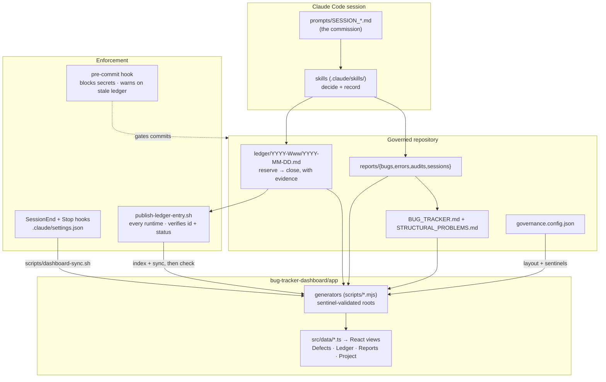

# claude-governance-kit

A project governance system for AI-assisted development with Claude Code. It gives any
repository an **execution ledger**, a **defect tracker**, a **reporting protocol**, a set
of **behavioural skills**, **enforcement hooks**, and a **local dashboard** that renders
all of it — so that what an AI session started, changed, verified, and left open is
always written down, and always visible.

Battle-tested on a real iOS project (58 tracked bugs, 50+ ledger entries), extracted
project-agnostic.

## The problem it solves

AI coding sessions produce work with no memory: a fix recorded as done that nobody
verified, a failure logged nowhere, a decision re-litigated every session, a credential
committed once and living in history forever. This kit is the discipline layer that
prevents that — as files, scripts, and hooks inside the repo, not as a service.

## What you get

| Piece | What it is |
|---|---|
| `ledger/` | Append-only execution log — one entry per task: reserved before work, closed after, with evidence |
| `obligations/` | What is owed by a date: a register with derived due dates, synced to Notion where calendar reminders fire (`scripts/obligations.sh`, `obligations` skill) |
| `reports/` | Bug / error / audit / session reports, each written with its own skill |
| `reports/bugs reports/BUG_TRACKER.md` | The live defect register, with an honest status vocabulary (fixed ≠ verified) |
| `STRUCTURAL_PROBLEMS.md` | The second register: tooling and process defects, plus lessons |
| `.claude/skills/` | 14 skills: seven that record what happened or what is owed, seven that decide what to do |
| `.claude/rules/` | Path-scoped invariants that load only when relevant code is opened |
| `scripts/` | Pre-commit gate (secrets block, ledger checks), ledger-id allocator, dashboard sync |
| `bug-tracker-dashboard/` | Local Vite/React dashboard generated from the Markdown — ledger, defects, reports, project inventory |
| `governance.config.json` | The single config file that adapts everything to your project |
| `prompts/` | Session prompts: a commission per session, sized to one context window |

## Install into a project

```bash
git clone https://github.com/<you>/claude-governance-kit
cd claude-governance-kit
./install.sh /path/to/your/project
```

The installer asks three questions (project name, short id, source directory), copies
everything in **without overwriting anything that already exists**, writes
`governance.config.json`, and installs the git pre-commit hook. Then:

```bash
cd /path/to/your/project/bug-tracker-dashboard/app
npm install && npm run sync && npm run dev   # → http://localhost:5173
```

## Update a project that already runs the kit

```bash
cd claude-governance-kit && git pull
./update.sh --dry-run /path/to/your/project   # see what would change
./update.sh /path/to/your/project
```

It replaces only kit-owned files (`scripts/`, the kit's skills, the governance rule, the
dashboard generators) and removes files the kit has retired. It never touches your
`CLAUDE.md`, ledger, tracker or your own rules. Instead it lists the templates whose
shape changed, each with the diff command to merge it by hand. It refuses to run over
uncommitted changes, so the update is one `git diff`, and it prints the command that
undoes it. The kit version lands in `.claude/governance-kit-version`.

A kit-owned file is replaced only when the project's copy is one the kit once shipped.
If the project has improved a kit file the kit never received, that file is kept and
listed as **diverged**. `./update.sh --collect /path/to/project` copies it back into the
kit, so you can review it and give it to every project. A file the project keeps as its
own version on purpose goes in `kit.projectOwned` in `governance.config.json`; the
update then leaves it alone. Between updates, `scripts/check-kit-drift.sh` warns at
commit time when a kit-owned file changes beyond the kit, so a change that should be
mirrored is noticed when it is made.

To measure what the kit costs a project, and what it has caught, run
`scripts/governance-audit.sh` there. It is read-only, makes no model calls, and prints
counts only.

## How it works



The flow: **work is commissioned** by a session prompt, **recorded** in the ledger as it
happens, **written up** by the reporting skills, **gated** by the pre-commit hook, and
**published** to the dashboard automatically at session end (and per turn) — idempotently,
keyed on what actually changed.

The hooks are a convenience of one runtime. In Claude Code, writing a reservation
publishes it, week index included. A closed entry is published deliberately, by
`scripts/publish-ledger-entry.sh <entry-id>`: that command regenerates the week index,
runs the same sync, and then checks that this exact id and status arrived. Runtimes
without the hook run it after reserving too. An entry nobody can see is an entry nobody
knew was in flight.

## The design rules that make it work

- **The ledger is the spine.** Reserve before starting, close when done, cite the entry ID
  from every other record. Nothing is duplicated into the ledger; it points outward.
- **Fixed is not verified.** The tracker separates *fixed, unverified* (a commit exists)
  from *fixed, verified* (named evidence exists). The dashboard renders the split.
- **Loud failure over silent skip.** Every generator validates its roots by sentinel and
  dies loudly; the sync hook logs every skip to a file *outside* the repo.
- **Block only what is never legitimate.** The pre-commit hook blocks credentials and
  warns on everything else — a gate that blocks real work gets bypassed until it means
  nothing.
- **No cron.** The dashboard syncs inside sessions only; a scheduler would be a second
  writer to the working tree.

Full description with the diagram rendered: open **`docs/index.html`** in a browser.

## Optional modules

- `modules/swift-xcode/` contains a Swift/Xcode audit skill, kept out of the core kit
  because it is toolchain-specific.
- `modules/seo-geo/` contains an SEO and GEO consultant skill with link-graph, cannibalization
  and research scripts, plus a project-wrapper template. It is for projects with a public site.

## Licence

MIT. The four vendored skills listed in `.claude/skills/UPSTREAM.md` are MIT-licensed by
Matt Pocock; provenance and licence text are in that file.
